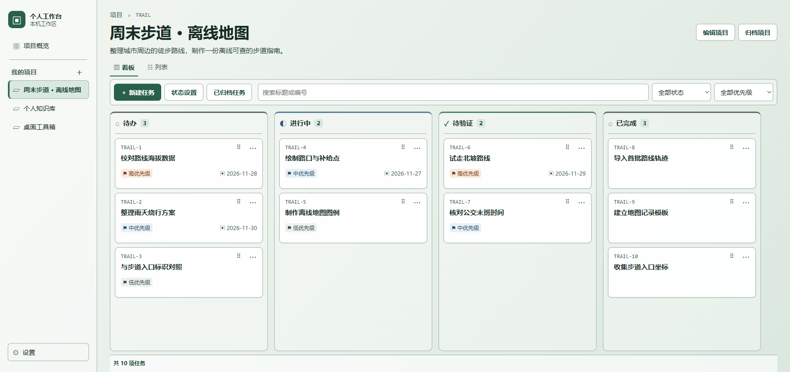
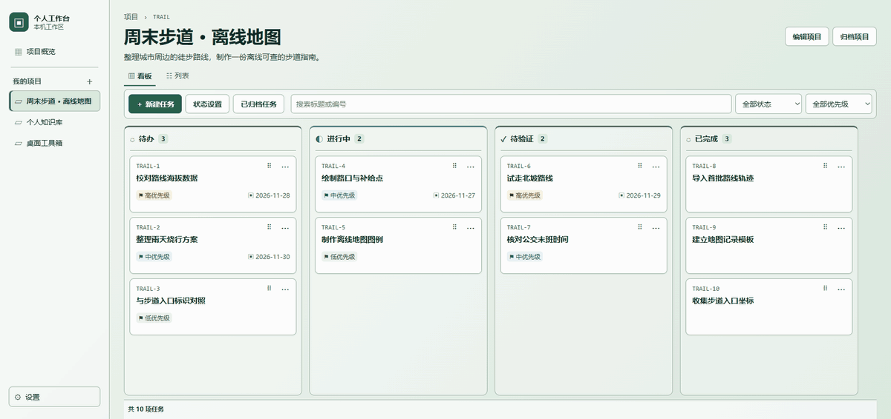
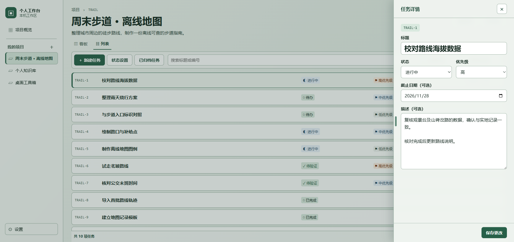
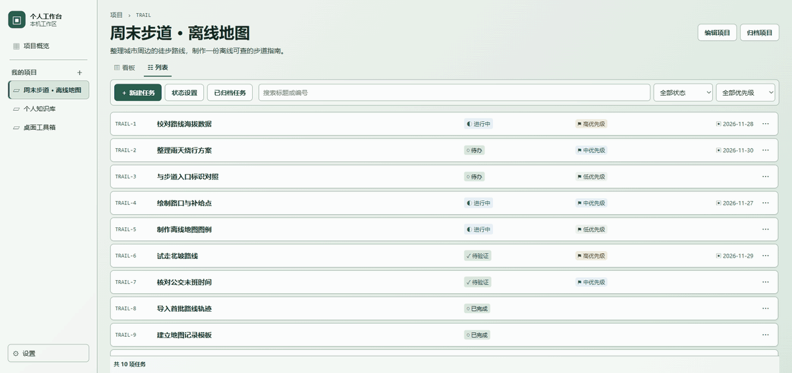

# 离线个人项目管理工作台

简体中文 · [English](README.en.md)

一个面向个人的 Windows 桌面项目管理工具。适合用来跟进学习计划、个人开发项目或日常事务：把工作拆成任务，在看板上拖动卡片推进状态，或在列表中搜索、筛选和编辑。项目、任务和工作流保存在本机 SQLite 中，无需注册账号或配置服务器。

**已发布：v0.1.0 · Windows 11 x64 便携版** · [下载 ZIP](https://github.com/xuzh0312/Local-offline-personal-project-management-workspace-similar-to-Plane/releases/download/v0.1.0/OfflineProjectWorkspace-0.1.0-Windows11-x64-portable.zip)

完整解压后双击 `Start.cmd` 即可启动。**上方下载是公开首版，不含永久删除。** 已在后续构建中验证的归档删除功能尚未随源码或便携包发布到本仓库。

> **一次开发流程实现** · **DSH 2.0.0 × GPT-6.2 Sol High** · **总耗费 421.6M Token** · **缓存命中率 98%**



## 我是怎么做出这个软件的

我用自己在 Harness-AI-Lite 中提供的 **DSH 2.0.0**，搭配 **GPT-6.2 Sol（High 推理深度）**，在一轮开发流程中实现了这个软件。[Harness-AI-Lite](https://github.com/xuzh0312/Harness-AI-Lite)

1. 我在项目介绍里只填了一句话：“这是一个电脑端离线个人项目管理工作台，类似Plane”
2. 我给 agent 发的命令是“完成这个软件”。
3. 之后我只回答 agent 的问题，大多数时候采纳它给出的推荐建议。

## 界面演示

以下截图和动图录自 Windows 便携版，使用示例项目数据。

### 在看板上推进任务

把「校对路线海拔数据」从「待办」拖到「进行中」，松手后即可更新任务状态。



### 从列表打开任务详情

点击列表中的任务，侧边面板会显示状态、优先级、截止日期和描述，可直接编辑。



<details>
<summary>观看详情面板打开与关闭的动图</summary>



</details>

## 功能介绍

| 功能 | 说明 |
| --- | --- |
| 多项目管理 | 创建项目，设置名称、唯一代号和描述；从概览进入各自工作区 |
| 任务管理 | 新建和编辑任务，记录标题、描述、状态、优先级和截止日期 |
| 任务编号 | 使用项目代号与项目内序号标识任务，例如 `DEMO-1` |
| 看板与列表 | 按状态分列展示任务，或切换为列表浏览，两种视图使用同一份数据 |
| 看板拖动 | 将卡片拖到其他状态列以推进任务，也可通过任务操作菜单更改状态 |
| 搜索与筛选 | 在当前项目内搜索任务标题或编号，按状态和优先级筛选 |
| 自定义状态 | 添加、重命名、调整顺序和删除状态，建立适合自己的工作流 |
| 归档与恢复 | 隐藏暂时不需要的项目和任务，保留内容并支持恢复 |
| 双语界面 | 支持简体中文和英文，保存本机语言偏好 |
| 五种主题 | 浅灰绿、浅紫、浅蓝、浅黄、纯白，保存本机主题选择 |
| 任务详情面板 | 在侧边面板编辑任务，支持调整面板宽度 |
| 本地存储 | SQLite 持久化保存业务数据，退出软件后保留已保存内容 |
| 手动备份 | 导出所有项目、状态和任务（含归档），恢复到空工作区 |

## 下载与启动

1. 将 ZIP **完整解压**到本地文件夹，不要在压缩包内直接运行。
2. 保持 `Start.cmd`、`app/` 和 `electron/` 在同一解压目录中。
3. 双击 `Start.cmd` 启动；退出时关闭软件窗口。

使用便携包不需要另外安装 Node.js、Electron 或开发依赖，也不需要改变 PowerShell 执行策略。启动命令窗口可能随软件一起打开。不要只复制包内的可执行文件。

## 使用流程

### 创建项目

从项目概览选择“新建项目”，填写名称、代号和可选描述。代号为 2–10 位英文字母或数字，以英文字母开头，保存为大写，同一工作区内不可重复。创建后可以编辑名称和描述，不能更改代号。

例如，为学习计划创建代号 `STUDY`，后续任务会显示为 `STUDY-1`、`STUDY-2` 等，方便搜索和定位。

### 添加任务并推进工作

打开项目，选择“新建任务”，填写标题，并按需设置描述、状态、优先级和截止日期。优先级可以是低、中、高或未设置。新任务默认使用项目的第一个状态。

新项目根据创建时的界面语言初始化“待办 / 进行中 / 已完成”或对应英文状态。通过“状态设置”可以改为“计划 / 开发 / 验证 / 完成”等流程。项目必须保留至少一个状态；删除含任务的状态前需指定其他状态接收任务，已归档任务也会迁移。

在看板中跨列拖动卡片，或使用任务操作菜单更改状态。点击任务打开详情面板，编辑后选择“保存更改”。截止日期用于记录和展示，当前没有到期通知功能。

### 查找与归档

在看板和列表之间切换，按标题或编号搜索，并结合状态与优先级筛选。搜索范围为当前项目的任务标题和编号，不包含描述全文或跨项目搜索。

归档任务后，可在项目内的「已归档任务」中恢复。归档项目会从概览隐藏，但保留任务和状态，可在「已归档项目」中恢复。要继续编辑已归档内容，请先恢复。

**后续构建（尚未发布）：** 两处归档界面都可在「恢复」旁选择「删除」。永久删除需要确认，且不能撤销。删除归档项目会同时移除其全部任务（包括未归档任务）和状态；单独删除归档任务只移除该任务，原编号不会重用。此前导出的备份不受影响。

### 切换语言与主题

在“设置”中选择简体中文或英文，以及五种浅色主题之一。语言与主题偏好保存在本机。切换界面语言不会自动翻译已有状态名称、项目名称或任务内容。

## 数据保存、备份与换机

### 数据位置

默认 SQLite 数据库位于当前 Windows 用户应用数据目录，通常为：

```text
%APPDATA%\offline-project-workspace\workspace.sqlite
```

**便携版表示程序免安装，数据默认保存在用户目录中。** 移动程序文件夹不会迁移数据，删除或重新解压程序也不会清空工作区。同一用户启动另一份程序副本，通常仍会使用同一工作区。

### 导出备份

选择“设置 → 备份与恢复 → 保存备份”，指定保存位置，默认文件名为 `workspace-backup.json`。

备份包含所有项目、状态、任务、归档标记和任务编号信息，不包含本机语言和主题偏好。备份需要手动触发，建议在换机、重装系统或重要整理前导出，并保存到其他安全位置。

虽然扩展名为 `.json`，当前备份使用本软件专用格式，包含标识头、逐行 JSON 记录和 SHA-256 完整性校验。请保留原始导出文件，并通过软件恢复。备份未加密，包含项目和任务文字内容。

### 恢复与迁移

1. 在原工作区导出备份，复制到目标电脑。
2. 在目标电脑完整解压便携包并启动。
3. 确认目标工作区没有任何项目。
4. 选择“设置 → 备份与恢复 → 从备份恢复”，选择备份文件。
5. 恢复后从概览打开项目，按需重新选择语言和主题。

恢复要求工作区**完全没有项目，包括已归档项目**。归档所有项目并不满足恢复条件；恢复也不会合并或覆盖已有项目。若要保留目标工作区的数据，请先导出该工作区的备份，再在没有项目的工作区恢复。

## 本地运行与当前边界

业务数据保存在本机，界面资源随程序交付，项目和任务操作不依赖云服务。当前没有账号登录、云端同步、多人协作或自动更新功能，也没有附件、子任务、到期提醒和统计报表。

主窗口禁用 Node.js 集成，启用上下文隔离与沙箱，通过受限的预加载 API 调用本地功能。程序禁用了拼写词典下载及部分后台联网行为；这些措施不能视为对操作系统和运行时所有网络行为的验证。

当前验收平台为 **Windows 11 x64**；Windows 10、macOS、Linux 及整机断网环境尚未实测。

## 技术与源码结构

采用 **Electron + React + TypeScript + SQLite**：Electron 提供桌面窗口和本地能力，React 实现界面，TypeScript 检查界面代码与 API 类型，SQLite 保存数据，esbuild 打包界面代码。

```text
project/
├── docs/media/     # 中英文文档使用的截图与动图
├── README.md       # 中文介绍
├── README.en.md    # 英文介绍
├── code/           # 软件源码与构建说明
└── LICENSE         # MIT 许可证；便携包通过 Releases 发布
```

| 源码文件 | 职责 |
| --- | --- |
| `main.cjs`、`main-language.cjs` | 启动、单实例、窗口、IPC 和原生菜单文案 |
| `preload.cjs`、`workspace-api.d.ts` | 向界面提供受限本地 API 及类型 |
| `storage.cjs` | SQLite 表结构、校验、迁移与事务 |
| `backup.cjs` | 备份读写与完整性校验 |
| `renderer.tsx`、`workspace.css` | 业务界面与样式 |
| `renderer-language.ts`、`workspace-motion.tsx` | 双语文案、拖动与面板交互 |

上述源码位于 `code/`。当前直接依赖 React / React DOM 19.1.1，开发依赖 TypeScript 5.9.3、esbuild 0.28.2；现有构建说明记录了 Node.js 24.22.3 和 Electron 43.3.0 Windows x64 的验证环境。

开发者请阅读 [源码与构建说明](code/README.md)。源码不附依赖、Electron 或 lockfile，`package.json` 没有 `start`、`build` 等 npm 脚本，需按说明准备依赖并在独立目录构建。普通用户直接使用便携包即可。

## 第三方许可

便携包中的 Electron 许可见 `electron/LICENSE` 和 `electron/LICENSES.chromium.html`；React、React DOM、scheduler 的 MIT 许可见 `licenses/`。本项目采用 [MIT 许可证](LICENSE)，第三方组件遵循各自许可。
